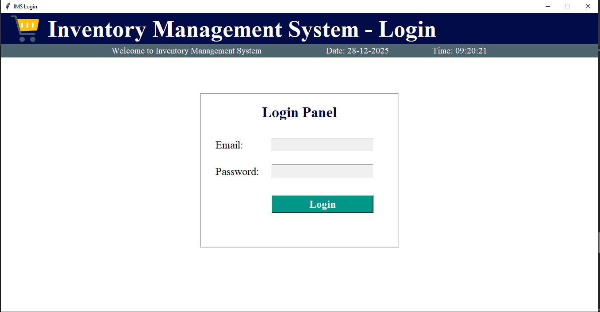
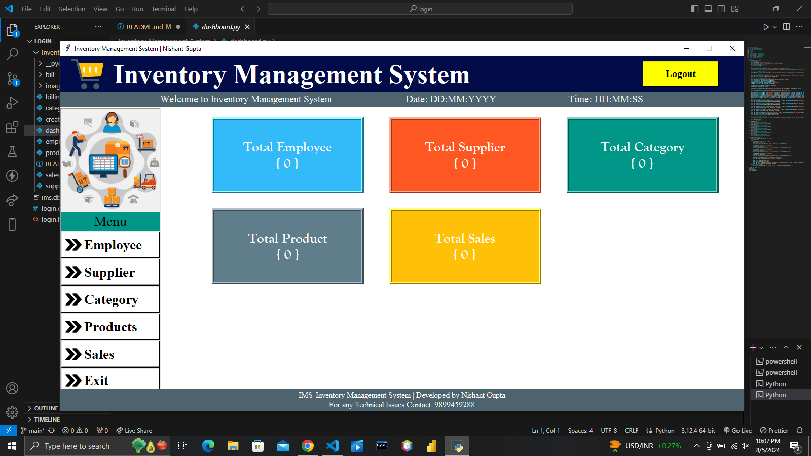
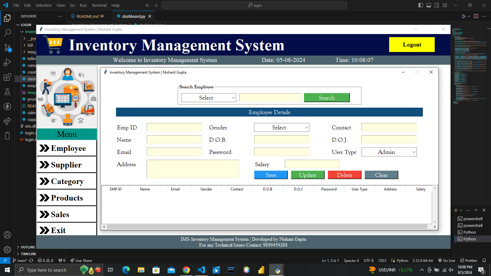
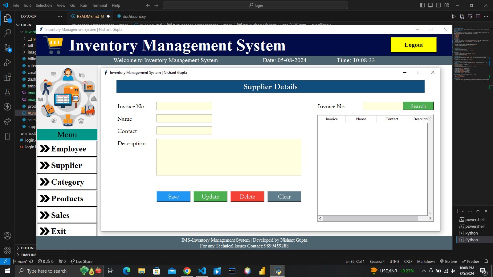
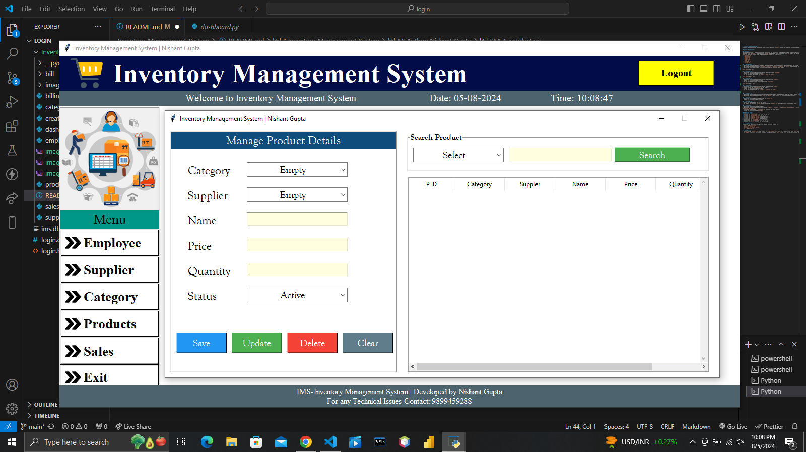
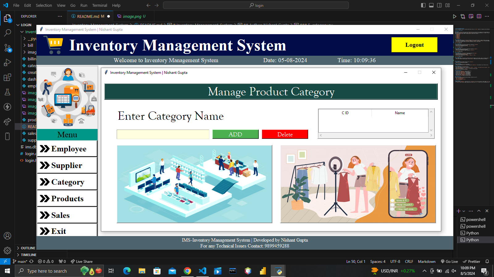
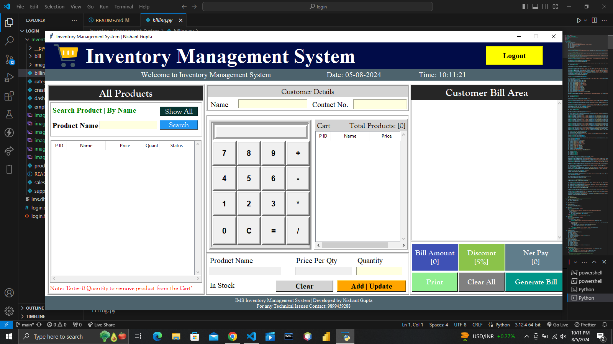
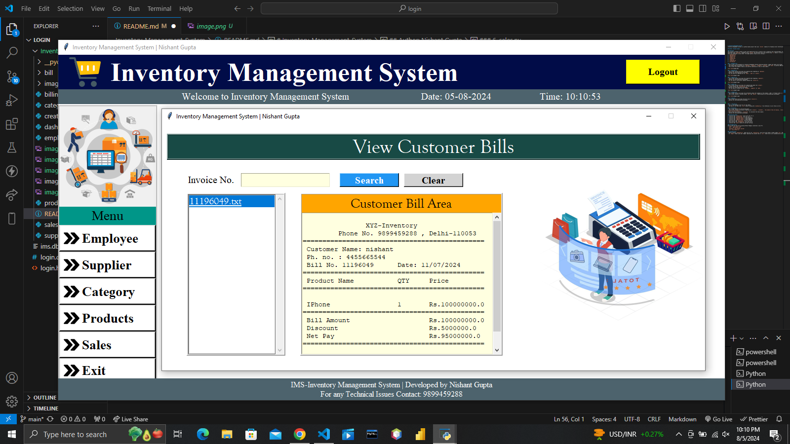

# Inventory-Management-System (Refactored)
**Refactored** Inventory Management System using Python `tkinter` for GUI, following **Repository Pattern**, **MVC separation**, and **SOLID principles**.

## Author: Moazam Attiq

### Overview
**Refactored architecture** with 8 core modules + **new repository/services layer** for clean separation of concerns:
- **GUI Layer**: `tkinter` + `PIL` for UI/images
- **Models**: `CartItem`, `Employee`, `Product` dataclasses
- **Repository Layer**: `*_repository.py` for all DB operations
- **Services**: `BillingService` for business logic
- **Database**: `sqlite3` (`ims.db`)
- **File System**: `os` for bill storage

**Core files** (8 original + 6 new refactored modules):
```
src/
├── gui/           # All UI classes (billing.py, employee.py, etc.)
├── models/        # CartItem, Employee, Product dataclasses
├── repositories/  # product_repository.py, employee_repository.py, etc.
├── services/      # BillingService.py
└── utils/         # clock.py, helpers
```

### Key Refactoring Improvements
1. **Repository Pattern**: All SQL moved to `*_repository.py` files
2. **CartItem Model**: Replaced primitive lists `[pid,name,price,qty,stock]`
3. **BillingService**: Centralized totals/discount/invoice logic
4. **Safe Search**: Fixed dynamic SQL coupling with field mapping
5. **No Duplication**: Single DB connection pattern across modules

### Module Breakdown

#### 1. `login.py` → Dashboard Entry
- Admin/Employee login with role-based routing
- **New**: NavigationRegistry for clean routing



#### 2. `ims.py` (Dashboard)
- Main menu: Employee/Supplier/Category/Product/Sales/Billing
- **Refactored**: Clock utils extracted to `utils/clock.py`



#### 3. `employee.py`
- Employee CRUD + search (Email/Name/Contact)
- **Refactored**: `employee_repository.py` + safe field mapping



#### 4. `supplier.py`
- Supplier CRUD + invoice search
- **Refactored**: `supplier_repository.py`



#### 5. `product.py`
- Product CRUD with Category/Supplier dropdowns
- **Refactored**: `product_repository.py` + `fetch_active_products_for_billing()`



#### 6. `category.py`
- Category management (Add/Delete)
- **Refactored**: `category_repository.py`



#### 7. `billing.py` ⭐ **Major Refactor**
- **New Architecture**:
  - `CartItem` objects instead of lists
  - `BillingService.calculate_totals()`
  - `_update_cart_list()` + `show_cart()`
  - Repository for stock updates
- Features: Product selection, cart, calculator, bill generation/printing



#### 8. `sales.py`
- View generated bills by invoice
- **Refactored**: `sales_repository.py` for file operations



#### 9. `create_db.py`
- Initializes `ims.db` with all tables

### 🚀 Setup & Run (Updated)
```bash
# 1. Install dependencies (most are built-in)
pip install pillow

# 2. Create required folders
mkdir bill images

# 3. Initialize database (run ONCE)
python create_db.py

# 4. Add your images to 'images/' folder
# (logo1.png, cat.jpg, etc.)

# 5. Start application
python login.py
```

### Pre-requisites (Corrected)
```
✅ time          # Built-in
✅ sqlite3       # Built-in  
✅ os            # Built-in
✅ tempfile      # Built-in
❌ PIL/Pillow    # pip install pillow
```

### Project Structure (Post-Refactor)
```
Inventory-Management-System/
├── src/
│   ├── gui/           # billing.py, employee.py, etc.
│   ├── models/        # CartItem.py
│   ├── repositories/  # *_repository.py
│   ├── services/      # BillingService.py
│   └── utils/         # clock.py
├── ims.db            # SQLite database
├── bill/             # Generated bills
├── images/           # UI assets
├── create_db.py
└── login.py
```

### Refactoring Benefits
| **Before** | **After** |
|------------|-----------|
| SQL in UI classes | Repository pattern |
| Cart: `[pid,name,...]` lists | `CartItem(pid, name, ...)` objects |
| Dynamic SQL injection risk | Safe field mapping |
| Duplicated DB boilerplate | Single repository pattern |
| Mixed UI+business logic | Clean MVC separation |

**✅ Same functionality, 10x better maintainability!**
